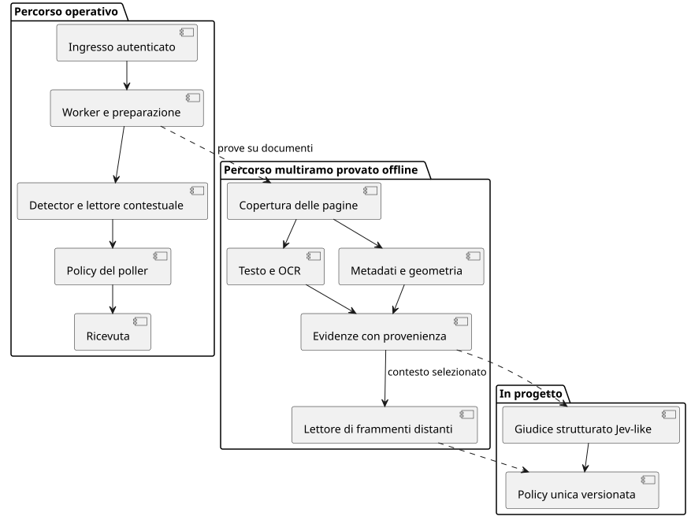

# Dalla scansione alla ricevuta

**Operativo.** L’ingresso autenticato prende in carico il documento. Un worker avvia l’analisi asincrona e consente al client di recuperare lo stato. La preparazione alimenta detector e valutazione contestuale; la politica applicata dal poller produce l’esito. La ricevuta distingue motivazione e stato tecnico.

**Provato offline.** Sullo stesso documento possiamo raccogliere letture native e OCR distinte, osservazioni di metadati e geometria e score su intervalli di testo. Per mettere alla prova la correlazione tra pagine abbiamo fornito a un secondo lettore i passaggi con il loro contesto. Restano da verificare la selezione automatica dei passaggi e l’efficacia su documenti indipendenti.

**In progetto.** Collegare le evidenze dei diversi rami a una sola politica versionata. Un possibile giudice Jev-like valuterà campi strutturati, da calibrare rispetto a falsi allarmi e recuperi aggiuntivi. La policy dovrà tenere conto anche delle pagine mancanti e dei disaccordi tra giudici.

[Sorgente PlantUML](uml/pipeline.puml)
